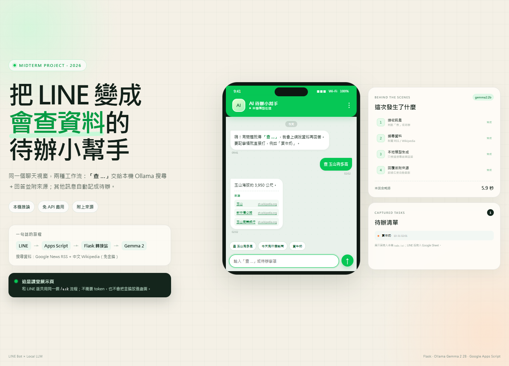
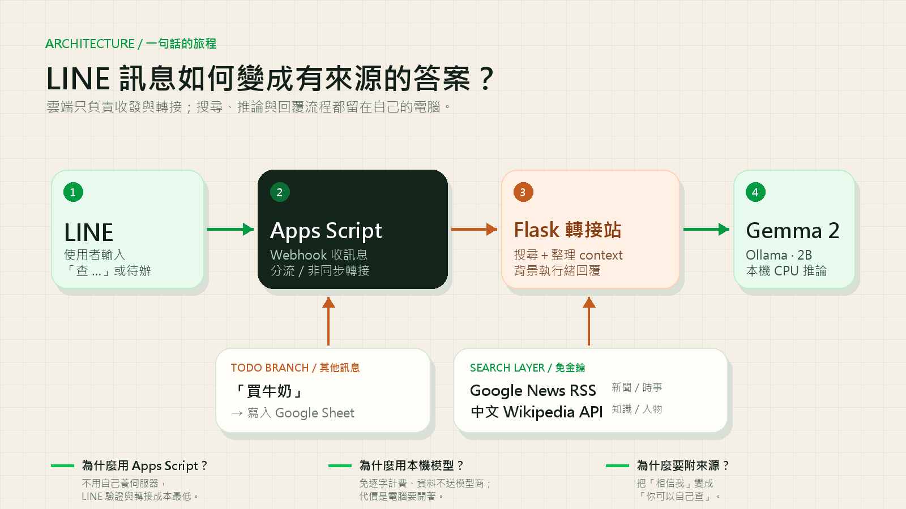

# LINE 待辦 × 本地 AI 查詢助手

**期中專題報告**

姓名：＿＿＿＿＿＿　學號：＿＿＿＿＿＿　日期：2026 / 10 / 31

---

## 摘要

這個專案把 LINE 變成一個「可以查資料，也可以記事情」的入口。使用者在聊天室輸入「查 …」時，系統會先搜尋 Google News RSS 與中文 Wikipedia，再把搜尋結果交給跑在自己電腦上的 Ollama Gemma 2 2B 模型整理，最後回覆一段繁體中文答案與可點擊的來源。其他訊息則自動寫入 Google Sheet 待辦清單。

專案解決兩個日常問題：第一，查資料往往要離開聊天室、開瀏覽器、再回來；第二，待辦常散落在聊天記錄裡。系統採「雲端收發、本機推論」的混合架構：Google Apps Script 負責接收 LINE Webhook，Flask 轉接站負責搜尋與呼叫本機模型。這麼做不需要昂貴的 API 額度，也能把模型推論留在家用電腦。實際測試中，暖機後一次查詢約 5.5～5.9 秒，冷啟動約 16 秒；11 個單元測試全部通過。

---

## 1. 問題與目標

### 1.1 我想解決什麼？

我每天使用 LINE 的頻率比瀏覽器高。遇到「玉山有多高」、「今天有什麼新聞」這類小問題時，我通常會切到瀏覽器搜尋，看完再回到 LINE；如果是「買牛奶」、「明天交報告」這類事情，則很容易被後面的聊天洗掉。現成的 AI 聊天機器人雖然能回答問題，但多半要把資料送到雲端模型，而且不會順手幫我記待辦。

因此我想做一個**在原本的聊天視窗裡完成兩件事**的助手：

1. 問即時或知識型問題時，得到有來源的答案。
2. 不想查、只想記事情時，一句話就進待辦清單。

### 1.2 給誰用？

- **主要使用者**：手機不離身、常用 LINE 的學生與小型團隊。
- **次要使用者**：想嘗試本地 LLM，但還沒有 GPU 或雲端預算的人。
- **使用情境**：課堂間查資料、查新聞標題、隨手記待辦、把 LINE 當成輕量第二大腦。

### 1.3 設計目標

| 目標 | 對應設計 |
|---|---|
| 不離開 LINE 就能查資料 | Webhook 接收訊息，回答直接回到同一個聊天室 |
| 答案要能查證 | 先搜尋，再把結果放進 prompt，最後附上來源 |
| 不要有逐字 API 費用 | 使用本機 Ollama，不呼叫收費模型 API |
| 待辦不要散在聊天記錄 | 非「查」訊息自動寫入 Google Sheet |
| 沒有固定伺服器也要能運作 | 用 Google Apps Script 當雲端入口，本機用 ngrok 穿透 |

---

## 2. 功能與使用流程

### 2.1 兩種模式

| 輸入 | 系統行為 | 輸出 |
|---|---|---|
| `查 玉山有多高` | 清理關鍵字 → 搜尋 Wikipedia → Gemma 2 整理 | 答案＋來源連結 |
| `查 今天台灣有什麼新聞` | 判斷為新聞題 → Google News RSS 優先 | 近期新聞摘要＋媒體來源 |
| `買牛奶` | 不進入 AI 流程，直接寫入待辦 | 「已記錄到待辦：買牛奶」 |

### 2.2 使用者看到的流程

1. 在 LINE 輸入訊息。
2. 「查 …」由 Apps Script 非同步轉給本機轉接站；其他訊息直接寫入 Google Sheet。
3. 轉接站搜尋、整理、呼叫 Ollama。
4. 轉接站直接呼叫 LINE Reply API，把答案與來源送回聊天室。



---

## 3. 系統架構



### 3.1 元件與責任

| 元件 | 位置 | 責任 |
|---|---|---|
| LINE Messaging API | 雲端 | 接收使用者訊息、提供 Reply API |
| Google Apps Script | 雲端 | Webhook 入口、訊息分流、非同步轉接、寫 Google Sheet |
| Flask 轉接站 | 自己的電腦 | 搜尋、整理 context、呼叫 Ollama、回覆 LINE |
| ngrok | 雲端隧道 | 把本機 Flask 變成 Apps Script 可連的 HTTPS 網址 |
| Ollama + Gemma 2 2B | 自己的電腦 | 繁體中文生成，CPU 可跑 |
| Google News RSS／中文 Wikipedia | 雲端 | 免金鑰的搜尋來源 |
| Google Sheet | 雲端 | 待辦資料儲存 |

### 3.2 為什麼是這個架構？

**（1）為什麼不全部放在本機？**

LINE 的 Webhook 必須是公開的 HTTPS 端點，家用網路通常沒有固定 IP，也不適合直接暴露連接埠。把 Webhook 放在 Apps Script，可以省掉自己維護雲端伺服器的工作；本機只需要處理「搜尋＋推論」這種比較重的工作。

**（2）為什麼不全部放在雲端？**

一開始我做過 Cloudflare Worker + Gemini API 的版本，程式比較短，但需要申請 API key，而且每次回答都有額度與費用考量。改成 Ollama 後，模型推論不用逐字計費，資料也不會送到模型供應商；代價是電腦必須開著。

**（3）為什麼選 Gemma 2 2B？**

這台電腦是純 CPU、記憶體有限。9B 模型生成太慢，會超過 LINE 的回覆時限；2B 版本明顯快很多，回答品質對「短問答＋有搜尋 context」的情境已經夠用。

**（4）為什麼要非同步？**

LINE Webhook 有回應時間限制。Apps Script 收到「查 …」後立刻回 200，Flask 在背景執行緒裡算答案，算完再呼叫 Reply API。這樣使用者不會看到 Webhook 逾時，也不會重複收到訊息。

---

## 4. 實作細節

### 4.1 訊息分流

`Code.gs` 的 `doPost` 只做三件事：解析事件、判斷是不是「查」開頭、決定要走 AI 或待辦。程式碼刻意保持簡單，讓錯誤範圍最小。

```javascript
if (userText.startsWith("查")) {
  askRelay(userText, event.replyToken);  // 轉接站稍後直接回 LINE
  handledByRelay = true;
} else {
  addToTodo(userId, userText);
  replyText = "已記錄到待辦：" + userText;
}
```

### 4.2 搜尋與關鍵字清理

使用者的問法通常很口語，例如「查 玉山有多高」。如果直接把整句丟給搜尋，結果會被「有多高」干擾。`clean_query` 會移除「查／查詢／請問／幫我」等前綴與「有多高／在哪裡／嗎」等疑問詞，留下「玉山」這種可搜尋的關鍵字。

系統用 `NEWS_HINTS` 判斷問題類型：

- 含有「新聞、最新、今天、股價、天氣、颱風」等字 → Google News RSS 優先，Wikipedia 補充。
- 其他問題 → 中文 Wikipedia 優先，Google News 補充。

兩個來源都免 API key。Google News 的文章連結又長又會轉址，因此來源網址採用媒體首頁；社群連結（Facebook、X、Instagram 等）會被跳過。

### 4.3 有根據的回答

搜尋結果只取前 3 筆放進 prompt，要求模型「只使用搜尋結果裡的事實；若找不到答案，就直接說查不到」。回答長度以 `num_predict=220` 控制，避免 CPU 生成太久；送回 LINE 前若超過 4,500 字會截斷，避免超過訊息長度上限。

這不是完美的防幻覺設計，但比「直接問模型」多了兩層保護：**先檢索、再生成**，以及**把來源公開給使用者**。

### 4.4 待辦與 Google Sheet

第一次收到非「查」訊息時，Apps Script 會自動建立「LINE Bot 待辦清單」試算表，欄位是時間、使用者 ID、待辦事項，並把試算表 ID 記在指令碼屬性 `SPREADSHEET_ID`。使用者不需要手動建立表單。

### 4.5 展示頁與祕密管理

課堂 demo 最大的風險是「網路、ngrok、LINE token 任一環節出錯」。因此我加了 `templates/demo.html` 展示頁：

- 不需要 LINE token，也不需要 Apps Script。
- 和正式版共用 `build_answer()` 與 `/ask` 流程。
- 右側同步顯示流程狀態、延遲與待辦清單。
- 可用 `start_demo.bat` 一鍵啟動。

在祕密管理上：

- 本機的 LINE token 只放在環境變數，不寫進程式碼。
- Apps Script 的 token 與轉接站網址放在「指令碼屬性」，`Code.gs` 只讀取，不硬編碼。
- `.gitignore` 排除 `.env`、`Code_filled.gs`、`start_local.bat`、`todo.txt`。
- 交件前執行 `python scripts/check_submission.py` 掃描 git 追蹤檔案。

---

## 5. 測試與結果

### 5.1 單元測試

執行：

```powershell
python -m unittest discover -s tests -v
```

結果：**11 個測試全部通過**。測試不需要 LINE token、ngrok 或 Ollama，使用 mock 取代外部服務。

| 測試類別 | 驗證內容 |
|---|---|
| 關鍵字清理 | 「查／查詢／請問」與疑問詞是否正確移除 |
| 搜尋路由 | 新聞題是否優先 Google News、知識題是否優先 Wikipedia |
| 回答組裝 | 是否附上「來源：」、沒有結果時是否能正常回覆 |
| HTTP API | `/ask` 同步回 JSON、`/demo/message` 分流、空訊息回 400 |
| 資訊安全 | `/health` 是否意外回傳 token |

### 5.2 展示頁端到端測試

實際在 Windows 11、Python 3.13、`gemma2:2b`、CPU 推論環境操作：

| 步驟 | 操作 | 結果 |
|---|---|---|
| 1 | 開啟 `http://127.0.0.1:5001/demo` | 顯示聊天 UI、流程面板、待辦清單 |
| 2 | 點「查 玉山有多高」 | 5.9 秒內回覆「玉山海拔約 3,950 公尺」與 3 個 Wikipedia 來源 |
| 3 | 點「買牛奶」 | 回覆「已記錄到待辦」，右側清單新增一筆 |
| 4 | 重新整理頁面 | 待辦仍存在（寫入本機 `todo.txt`） |

### 5.3 效能觀測

| 情境 | 搜尋 | 模型生成 | 總耗時 |
|---|---:|---:|---:|
| 冷啟動（模型尚未載入） | — | 14.0 秒 | 16.2 秒 |
| 暖機後查詢 | 2.2 秒 | 3.3 秒 | 5.5 秒 |
| 展示頁回歸測試 | — | — | 5.9 秒 |

冷啟動的 16.2 秒主要花在載入模型，不是完整查詢的代表值；暖機後的 5.5～5.9 秒才是一般使用時的感受。這是單次觀測，不是嚴謹 benchmark，網路、CPU 負載與模型是否已載入都會影響結果。這也是為什麼展示頁啟動時會先做一次 `warm_up()`。

### 5.4 LINE 端到端測試

LINE 端需要自己的 Channel token 與 ngrok 網址，因此不在自動化測試裡。開發時的手動檢查清單如下：

- `ollama list` 看得到 `gemma2:2b`。
- 轉接站首頁顯示「轉接站運行中！」。
- LINE 傳「買牛奶」→ Google Sheet 新增一列。
- LINE 傳「查 玉山有多高」→ 回覆有答案與來源。
- 關掉轉接站 → LINE 端有錯誤提示，不會永久轉圈。
- 重新部署 Apps Script 後，Webhook Verify 成功。

> 交件前為避免把 token 放進 repo 或截圖，LINE 連線設定不寫進報告；回歸測試以同一個 `/ask` 流程的展示頁完成。

### 5.5 安全檢查

```text
掃描 git 追蹤檔案……
OK：沒有發現金鑰、Bearer token、ngrok authtoken 或 Apps Script 部署網址。
```

---

## 6. 討論與限制

### 6.1 做得好的地方

1. **一個入口解決兩個高頻動作**：查資料與記待辦都在 LINE 裡完成，減少了切換 App 的成本。
2. **答案可追溯**：即使 2B 模型答得不完美，使用者仍能點開來源自己確認。
3. **成本低、可複製**：搜尋來源免金鑰，模型在本機跑，沒有逐字費用。
4. **有展示頁**：把「需要 token、ngrok、手機」的 demo 風險降到最低，課堂上仍能展示同一套流程。

### 6.2 還沒解決的地方

1. **電腦必須開著**：休眠、關機或 Ollama 沒啟動，LINE 就查不到。
2. **ngrok 免費網址會變**：每次重開都要更新 Apps Script 的轉接站網址。
3. **搜尋深度不足**：目前只讀 RSS 標題與 Wikipedia 摘要，沒有抓文章正文；「今天的新聞」可能拿到不夠即時的結果。
4. **2B 模型能力有限**：已用 prompt 限制，但仍可能誤解問題或給出過度精簡的答案。
5. **Webhook 尚未驗證簽章**：公開部署後，知道網址的人都能送假事件。這是目前最需要補的安全洞。
6. **Google Sheet 會存使用者 ID**：多人使用時要考慮保留期限、存取權限與個資問題。

---

## 7. 下一步

1. **穩定部署**：把 ngrok 換成 Cloudflare Tunnel + 固定網域，讓 Webhook 不用每次重設。
2. **Webhook 安全**：在 Apps Script 驗證 `X-Line-Signature`，加上 allowlist 或 shared secret。
3. **待辦進化**：支援「列表／完成／刪除／截止日」，或直接串 Google Tasks。
4. **檢索進化**：抓文章正文、切 chunk、做簡單 RAG，而不是只餵 RSS 摘要。
5. **模型 fallback**：電腦關機時改用雲端小模型，讓服務不中斷。
6. **回覆體驗**：用 LINE Flex Message 把來源做成按鈕，減少量點與長網址。

---

## 8. 學習與反思

這個專案讓我學到，**AI 應用最難的通常不是「叫模型回答」**，而是周邊的工程：Webhook 逾時、公開網址、搜尋品質、token 管理、錯誤處理，以及「怎麼在課堂上穩定 demo」。一開始我把重點放在模型，後來發現真正讓專案可用的，是非同步回覆、把搜尋結果放進 prompt、以及一個不需要憑證的展示頁。

AI 助理在這個過程中幫了很多：它可以快速產生第一版、解釋錯誤訊息、提出替代方案；但它也會給出看起來合理、實際上不能跑的程式。最後還是要靠自己讀 log、實際執行、設計測試，才能把「能跑」變成「可以交」。

---

## 附錄：重現步驟

```powershell
# 1. 安裝依賴
pip install -r requirements.txt

# 2. 下載模型
ollama pull gemma2:2b

# 3. 課堂展示（不需要 LINE token）
.\start_demo.bat

# 4. 跑測試
python -m unittest discover -s tests -v

# 5. 交件前安全檢查
python scripts/check_submission.py
```

完整安裝與 LINE 設定請見 repo 的 `README.md`。
